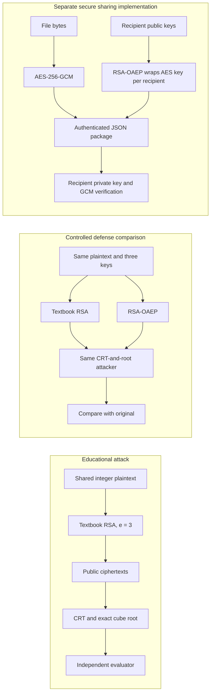

# BroadcastGuard

**Exploiting RSA Broadcast Vulnerabilities and Designing a Secure Multi-Recipient Encryption System**

**USTH | Introduction to Cryptography | Midterm Project | 2026**

BroadcastGuard is an educational cryptography research and software project. It studies low-exponent RSA broadcast recovery, compares deliberately unpadded textbook RSA with RSA-OAEP under controlled conditions, and demonstrates authenticated multi-recipient file protection with hybrid cryptography. The project brings together cryptographic mathematics, controlled experiments, reproducible evidence, interactive demonstrations, and hybrid file encryption.

## Project overview

Encrypting the same integer message for several recipients with textbook RSA and a small public exponent can expose the message through public ciphertexts alone. BroadcastGuard lets students inspect the Chinese Remainder Theorem (CRT) and exact integer-root calculation, then tests the same attacker against randomized RSA-OAEP. A separate Secure Sharing module illustrates how to encrypt file content once and deliver its encryption key to several authorized recipients.

The attack and comparison are teaching experiments. The file-sharing module uses library implementations of AES-GCM and RSA-OAEP; it does not use textbook RSA.

## Live demo and project resources

| Resource | Link |
| --- | --- |
| Source repository | [Dung092005/Crypto-project](https://github.com/Dung092005/Crypto-project) |
| Interactive application | Run locally with the [Quick start](#quick-start). The public deployment URL is pending independent verification. |
| Report materials | [Manuscript candidates and review notes](report/); the submitted version has not been confirmed. |
| Archived experimental evidence | [Evidence register](docs/EXPERIMENT_EVIDENCE.md) and [official run](docs/evidence/official-20261106T083221Z-3bbf57cc/) |
| Reproduction and analysis | [Reproducibility guide](docs/REPRODUCIBILITY.md), [experiment protocol](docs/EXPERIMENT_PROTOCOL.md), and [analysis artifacts](docs/analysis/) |

The PDF named `BroadcastGuard_midterm_final_edited.pdf` is not in the published repository. The available report PDFs are candidates or reviewed versions, so this README does not label one as the final submission.

## Key features

### 1. Attack Lab — Streamlit UI and CLI

- Generates three RSA-2048 keypairs with public exponent `e = 3`, then encrypts the same integer message for Alice, Bob, and Charlie using deliberately vulnerable textbook RSA.
- Gives the attacker public `(n, e, c)` observations only. The attacker applies CRT and an exact integer cube root; a separate experiment evaluator checks the candidate against the original message.
- Analyzes all seven nonempty recipient subsets, including cases where fewer than three ciphertexts suffice.

### 2. Defense Lab — Streamlit UI and CLI

- Compares textbook RSA and RSA-OAEP using the same plaintext, the same three RSA-2048/`e = 3` keypairs, and the same CRT-and-root attacker.
- Configures OAEP with SHA-256, MGF1-SHA-256, and an empty label. Checks authorized decryption for all three recipients and observes whether repeated OAEP encryptions produce distinct ciphertexts.
- Keeps the attacker's calculation separate from the experimenter's knowledge of the original plaintext.

### 3. Secure Sharing — Python API and CLI demo

- Encrypts file bytes once with AES-256-GCM, using a fresh 256-bit key and 96-bit nonce for each encryption.
- Wraps that AES key independently for each of one to five recipients using RSA-2048/`e = 65537` with OAEP-SHA-256/MGF1-SHA-256. Each recipient needs their matching private key to unwrap it.
- Serializes a versioned JSON package with Base64 binary fields. Its canonical JSON header, including recipient and wrapped-key entries, is AES-GCM associated data (AAD). Parsing, format checks, key matching, and authenticated decryption reject the tested invalid or altered packages without returning plaintext.

Secure Sharing currently has **no Streamlit page**. Its demonstrated workflow is local Python code; the in-memory demo keys are not a key-distribution service. See the [package design](docs/SECURE_SHARING_DESIGN.md).

## Research questions and experimental findings

1. **RQ1:** Under which mathematical condition does CRT-and-root recover a shared integer from textbook RSA ciphertexts?
2. **RQ2:** How does randomized RSA-OAEP change the outcome of the same tested attack when keys and plaintext are fixed?
3. **RQ3:** How do file size, recipient count, and JSON/Base64 packaging affect hybrid encryption time and storage?
4. **RQ4:** Which invalid or modified packages are rejected, and what does successful authenticated decryption establish or fail to establish about sender identity?

The [official archived run](docs/EXPERIMENT_EVIDENCE.md) supports these bounded findings:

| Experiment | Design | Observed result |
| --- | --- | --- |
| **E1 · Broadcast recovery** | 20 independent RSA key sets × 4 messages × 7 nonempty subsets = **560 observations** | **560/560** outcomes agreed with the mathematical bound prediction; this is prediction agreement, **not** 560 successful attacks. Minimum successful ciphertext counts: 1 for one-byte `B`; 2 for 96 repeated `B` bytes; 3 for 180 repeated `B` bytes; 1 for 95 zero bytes followed by `0x02`. |
| **E2 · Textbook vs OAEP** | 60 paired comparisons: 3 messages within each of 20 independent key-set blocks | The tested attacker recovered the original textbook-RSA message in **60/60** comparisons and the OAEP message in **0/60**. Intended OAEP decryption succeeded for all three recipients in **60/60** comparisons. Repeated OAEP ciphertexts differed in the recorded checks. |
| **E3 · Hybrid workflow** | 10 KiB, 100 KiB, and 1 MiB files × 1, 3, and 5 recipients × 20 measured repetitions per configuration | For 1 MiB and one recipient, mean encrypt-and-wrap time was **0.480 ms**, JSON/Base64 serialization **7.232 ms**, and their combined workflow **7.712 ms**. Serialization was **93.78%** of that measured mean; RSA key generation was timed separately. |
| **E4 · Package validation** | 11 selected correctness cases | One valid package was accepted; ten invalid or altered inputs were rejected, with no plaintext returned for those ten cases. |

For textbook RSA with the same integer `M`, pairwise-coprime moduli, and `e = 3`, CRT reconstructs `X = M³ mod N`, where `N` is the product of the selected moduli. If `M³ < N`, then `X = M³` as an integer and its cube root is `M`. The two 96-byte E1 samples show why the **integer value**, rather than byte length alone, determines this bound: 95 leading zero bytes followed by `0x02` represent the integer 2.

E2 evaluates one attack method, not every possible attack on RSA-OAEP. E3's observed serialization cost belongs to this Python JSON/Base64 packaging workflow, not AES-GCM alone; timing is specific to the recorded machine and environment. E4 covers its selected cases, not every possible malformed or malicious package.

## How it works



## Quick start

Requires Git and **Python 3.11+**. Python 3.12 is the version used for the archived experiments. The `dev` and `analysis` extras install the test and analysis dependencies used below.

### Windows PowerShell

```powershell
git clone https://github.com/Dung092005/Crypto-project.git
cd Crypto-project
py -3.12 -m venv .venv
.\.venv\Scripts\python.exe -m pip install -e ".[dev,analysis]"
.\.venv\Scripts\python.exe -m streamlit run app.py
```

If Python 3.12 is unavailable, use `py -3.11`. Open **http://localhost:8501** after Streamlit starts.

### macOS / Linux

```bash
git clone https://github.com/Dung092005/Crypto-project.git
cd Crypto-project
python3 -m venv .venv
.venv/bin/python -m pip install -e '.[dev,analysis]'
.venv/bin/python -m streamlit run app.py
```

Use Python 3.11 or newer for `python3`; open **http://localhost:8501**. The app entry point is `app.py`. Deployment configuration is documented in [DEPLOYMENT.md](docs/DEPLOYMENT.md).

## Usage and demonstrations

1. In **Attack Lab**, select **Medium · 96 bytes** and click **Generate RSA Scenario**. Intercept only Alice's ciphertext and click **Run Broadcast Attack**; then select Alice and Bob and run it again. Compare the independent evaluator's recovery result and the seven-subset table. The 96-byte preset is `b"B" * 96`.
2. In **Defense Lab**, choose the same preset and click **Run Defense Comparison**. Inspect the textbook/OAEP outcomes, shared public keys, repeated-encryption check, and authorized-decryption results.
3. Run the command-line examples from the repository root. The sharing example encrypts a synthetic file, decrypts it for the three demo recipients, and checks a wrong key and modified ciphertext:

```powershell
.\.venv\Scripts\python.exe -X utf8 examples\04_attack_lab.py
.\.venv\Scripts\python.exe -X utf8 examples\05_conditions_analyzer.py
.\.venv\Scripts\python.exe -X utf8 examples\06_defense_lab.py
.\.venv\Scripts\python.exe -X utf8 examples\07_hybrid_sharing.py
```

On macOS/Linux, replace `.\.venv\Scripts\python.exe` with `.venv/bin/python` and use forward slashes in example paths. Earlier introductory demonstrations `01`–`03` also remain in [examples/](examples/).

## Reproducibility

The archived E1–E4 data were generated by source commit `46c455819e4588736d4777c252d844fa03e7caf3`. The official run records its Python/library versions, hardware, case grid, and repetition settings. The commands below validate existing evidence and regenerate analysis in a **new directory**; they do not rerun randomized benchmarks or overwrite the official archive.

```powershell
.\.venv\Scripts\python.exe -m experiments.run_experiments --validate-only docs/evidence/official-20261106T083221Z-3bbf57cc
.\.venv\Scripts\python.exe -m analysis.run_analysis --input docs/evidence/official-20261106T083221Z-3bbf57cc --output ../broadcastguard-analysis-review
.\.venv\Scripts\python.exe -m pytest -q
```

On macOS/Linux, substitute `.venv/bin/python`. The analysis command validates its input, then writes six tables and four figures without new cryptographic measurements. See the [evidence register](docs/EXPERIMENT_EVIDENCE.md), [protocol](docs/EXPERIMENT_PROTOCOL.md), [reproducibility guide](docs/REPRODUCIBILITY.md), [analysis directory](docs/analysis/), and [final engineering audit](docs/FINAL_AUDIT.md) for provenance, methods, and interpretation.

## Security scope and limitations

- **Textbook RSA is intentionally insecure** and is used only in the educational Attack and Defense Labs. Secure Sharing uses RSA-OAEP for key wrapping.
- A failed CRT-and-root attempt does not cover other RSA attacks. E2's OAEP non-recovery is an empirical result for the tested method, **not a formal security proof**.
- Secure Sharing assumes recipient public keys were authenticated independently. A key fingerprint helps identify key material but does not prove a person's identity.
- AES-GCM authenticates ciphertext and the header used as AAD under the unwrapped key. Successful decryption confirms integrity under that key; it does **not independently authenticate the sender** or prove who created the package.
- The prototype has no sender digital signatures, replay protection, complete PKI, revocation mechanism, or long-term private-key management. It is not a production-ready file-sharing service.
- File content is handled in memory with a 5 MiB file limit. Performance results describe the archived Windows/Python environment and should not be generalized to other machines or deployments.

## Project structure

```text
app.py                    Streamlit router: Attack and Defense Labs
broadcastguard/           Cryptographic labs, secure sharing API, UI helpers
app_pages/                Two Streamlit page entry points
examples/                 Runnable Python demonstrations
experiments/              Offline E1–E4 runner and evidence validator
analysis/                 Evidence-derived tables and figures
docs/                     Protocol, archived evidence, analysis, design, audits
report/                   Manuscript source, report candidates, review notes
tests/                    Backend, integration, and Streamlit AppTest checks
```

Maintainer decisions and historical task checkpoints remain in [docs/](docs/). Contributions should follow [AGENTS.md](AGENTS.md) and the [review checkpoint](docs/REVIEW_CHECKPOINT.md); report problems through [GitHub Issues](https://github.com/Dung092005/Crypto-project/issues).

## Authors and academic context

BroadcastGuard is a Midterm Project for **Introduction to Cryptography** at the **University of Science and Technology of Hanoi (USTH)**, November 2026. It is maintained by the BroadcastGuard project team; `Dung092005` owns the GitHub repository. Individual contribution roles are not assigned here.

## License

The source code is released under the [MIT License](LICENSE). Copyright © 2026 BroadcastGuard contributors.
