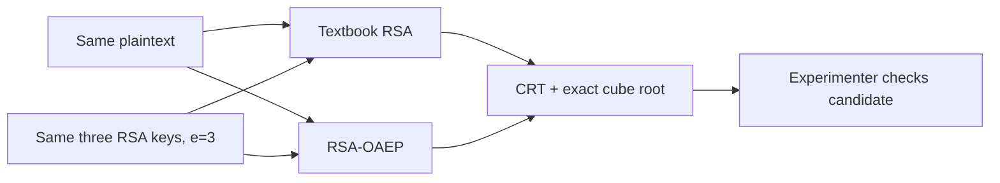

# BroadcastGuard

## TASK 09 analysis artifacts

The validated TASK 08 evidence has a reproducible scientific analysis package. From the repository root, run:

    python -m experiments.run_experiments --validate-only docs/evidence/official-20261106T083221Z-3bbf57cc
    python -m analysis.run_analysis --input docs/evidence/official-20261106T083221Z-3bbf57cc --output docs/analysis

The analysis reads the official CSV evidence, regenerates compact E1-E4 and key-generation tables plus four report-ready figures as PNG/SVG, and does not run cryptographic benchmarks. Methods, findings, limitations, the claim-evidence matrix and figure index are in docs/analysis/. Install optional analysis dependencies with the analysis extra when needed: pip install -e ".[analysis]". The final academic report remains a later deliverable.

For final verification, follow [REPRODUCIBILITY](docs/REPRODUCIBILITY.md), [FINAL_AUDIT](docs/FINAL_AUDIT.md) and the [report readiness checklist](docs/REPORT_READINESS_CHECKLIST.md). TASK 10 corrects figure layout and audits the existing official evidence; it does not create a new benchmark run or an academic report.

**An interactive cryptography lab for understanding RSA Broadcast Attack and its defenses.**
Ứng dụng giáo dục mật mã cho project giữa kỳ tại USTH. Người học quan sát một
cuộc tấn công trên Textbook RSA, thử lại cùng phép tấn công với RSA-OAEP, rồi
khám phá cách AES-GCM và RSA-OAEP phối hợp để chia sẻ file cho nhiều người.

> **Current state:** Attack Lab và Defense Lab có giao diện Streamlit. Secure
> Sharing đã có Python API và CLI demo; giao diện file sharing chưa triển khai.
> Người dùng đã xác nhận public deployment hoạt động; README chưa công bố URL
> đã kiểm chứng độc lập. Bộ số liệu official và giới hạn diễn giải nằm trong
> [EXPERIMENT_EVIDENCE](docs/EXPERIMENT_EVIDENCE.md).

## What can you do?

| Lab | Trải nghiệm | Trạng thái |
| --- | --- | --- |
| **Attack Lab** | Chọn plaintext, tạo ba ciphertext RSA-2048/e=3, chọn tập Alice/Bob/Charlie mà Eve thu được, xem CRT, căn bậc ba và bảy tổ hợp người nhận. | Interactive UI + CLI |
| **Defense Lab** | So sánh Textbook RSA và RSA-OAEP trên **cùng plaintext, cùng ba khóa, cùng phép thử của Eve**; kiểm tra giải mã hợp lệ và tính ngẫu nhiên của OAEP. | Interactive UI + CLI |
| **Secure Sharing** | Mã hóa file bytes một lần bằng AES-256-GCM, bọc khóa AES riêng cho 1–5 người nhận bằng RSA-OAEP, kiểm tra gói dữ liệu và phát hiện chỉnh sửa. | Python API + CLI; chưa có UI |

### The central experiment



Với Textbook RSA, nếu cùng số nguyên thông điệp `M` được gửi bằng `e = 3`
và `M³ < n₁n₂n₃`, CRT tái dựng đúng `M³` để lấy căn nguyên. Thông điệp rất
ngắn đôi khi chỉ cần **một** ciphertext; số bản mã cần thiết phụ thuộc giá
trị `M` và tích modulus của tập được chọn. Một căn nguyên chính xác vẫn phải
được đối chiếu với plaintext thật. Defense Lab dùng OAEP để thay đổi biểu
diễn trước phép RSA; việc CRT-and-root không lấy lại plaintext trong một
thí nghiệm **không** phải chứng minh an toàn tuyệt đối.

## Quick start

Yêu cầu **Python 3.11+** và Git. Môi trường dự án đã được kiểm chứng với
Python 3.12, Streamlit 1.60 và `cryptography` 48.0.1.

### Windows · PowerShell

```powershell
git clone https://github.com/Dung092005/Crypto-project.git
cd Crypto-project
py -3.12 -m venv .venv
.\.venv\Scripts\python.exe -m pip install -e ".[dev]"
.\.venv\Scripts\python.exe -m streamlit run app.py
```

Mở `http://localhost:8501`. Không cần activate venv, quyền admin hay đổi
PowerShell ExecutionPolicy. Nếu chỉ có Python 3.11, thay `py -3.12` bằng
`py -3.11`.

### macOS / Linux

```bash
git clone https://github.com/Dung092005/Crypto-project.git
cd Crypto-project
python3 -m venv .venv
.venv/bin/python -m pip install -e '.[dev]'
.venv/bin/python -m streamlit run app.py
```

Ứng dụng dùng `app.py` làm entrypoint cho cả máy local và Streamlit Community
Cloud. Xem [hướng dẫn triển khai](docs/DEPLOYMENT.md); việc public deployment
và xác minh URL do người dùng thực hiện riêng.

## Demo in two minutes

1. **Attack Lab** (trang mặc định): chọn mẫu 1, 96 hoặc 180 byte; bấm
   **Generate RSA Scenario**. Chọn ciphertext mà Eve thu được rồi bấm
   **Run Broadcast Attack**. Xem kết quả, năm bước toán học, bảy tập con và
   phép quét độ dài thông điệp.
2. Chuyển sang **Defense Lab** ở thanh điều hướng. Chọn cùng một mẫu, bấm
   **Run Defense Comparison**. Đọc hai panel Textbook/OAEP, bảng ba public
   keys dùng chung, quan sát mã hóa lặp lại và trạng thái giải mã của Alice,
   Bob, Charlie. Input tùy chỉnh là UTF-8, tối đa **190 byte** cho OAEP-SHA256
   với RSA-2048; dữ liệu không bị cắt ngắn.
3. Muốn xem Secure Sharing trước khi có UI, chạy CLI demo với file giả lập:

   ```powershell
   .\.venv\Scripts\python.exe -X utf8 examples\07_hybrid_sharing.py
   ```

   Trên macOS/Linux, dùng `.venv/bin/python` và đường dẫn
   `examples/07_hybrid_sharing.py`.

## Tests and CLI examples

### Offline research experiments (TASK 08)

The experiment runner is separate from Streamlit and never starts on app import. It records four controlled groups: attack conditions (E1), paired Textbook/OAEP trials (E2), hybrid file timing/overhead (E3), and package failure cases (E4). The **quick** run checks the pipeline only; the **official** run uses at least 20 measured repetitions per timing configuration and 20 independent e=3 key sets.

```powershell
.\.venv\Scripts\python.exe -m experiments.run_experiments --mode quick --output results/quick-check
.\.venv\Scripts\python.exe -m experiments.run_experiments --mode official --repetitions 20 --warmup 2 --output results/official-check
.\.venv\Scripts\python.exe -m experiments.run_experiments --validate-only results/official-check
```

Use a new output directory for each run. `results/` is ignored by Git; reviewed, sanitized evidence is indexed in [EXPERIMENT_EVIDENCE](docs/EXPERIMENT_EVIDENCE.md). Read the [experiment protocol](docs/EXPERIMENT_PROTOCOL.md) before interpreting timing or attack outcomes. This is experimental verification, not a security proof or the academic report.

```powershell
.\.venv\Scripts\python.exe -m pytest
.\.venv\Scripts\python.exe -X utf8 examples\04_attack_lab.py
.\.venv\Scripts\python.exe -X utf8 examples\05_conditions_analyzer.py
.\.venv\Scripts\python.exe -X utf8 examples\06_defense_lab.py
.\.venv\Scripts\python.exe -X utf8 examples\07_hybrid_sharing.py
```

Các demo `01_demo_de_hieu.py`–`03_demo_oaep.py` vẫn ở thư mục `examples/`.
Bộ test gồm toán học xác định, integration RSA-2048, kiểm tra gói mã hóa và
Streamlit AppTest. Mốc TASK 07 có **220 tests PASS**; xem lệnh và giới hạn
môi trường trong [PROGRESS](docs/PROGRESS.md). RSA/OAEP dùng nguồn ngẫu nhiên
bảo mật, nên ciphertext và thời gian chạy không phải snapshot cố định.

## Architecture

```text
app.py                         Streamlit router (st.Page / st.navigation)
app_pages/                     Attack Lab, Defense Lab entrypoints
broadcastguard/
  math_core.py                 CRT, exact integer root, bytes ↔ integer
  attack_lab.py                Scenario builder, public-only attacker, evaluator
  conditions_analyzer.py       Seven subsets and controlled message-length sweep
  defense_lab.py               Textbook RSA vs RSA-OAEP controlled comparison
  hybrid_sharing.py            AES-GCM file encryption and RSA-OAEP key wrapping
  ui/                          Page rendering and presentation helpers
examples/                      Seven runnable CLI demonstrations
tests/                         Backend, integration and Streamlit AppTest tests
docs/                          Design, decisions, progress and deployment notes
```

Chi tiết thuật toán và package format nằm trong [PROJECT_CONTEXT](docs/PROJECT_CONTEXT.md),
[SECURE_SHARING_DESIGN](docs/SECURE_SHARING_DESIGN.md) và
[DECISIONS](docs/DECISIONS.md). Agent mới nên đọc
[REVIEW_CHECKPOINT](docs/REVIEW_CHECKPOINT.md) trước khi sửa code.

## Security scope

- **Textbook RSA cố ý không an toàn** và chỉ dùng trong Attack/Defense Lab.
  Secure Sharing không dùng Textbook RSA.
- Defense Lab giữ RSA-2048/**e=3** ở cả hai mode để cô lập tác động của
  OAEP-SHA256/MGF1-SHA256. Secure Sharing dùng RSA-2048/**e=65537** và
  AES-256-GCM với khóa và nonce mới mỗi lần mã hóa.
- Gói Secure Sharing xác thực ciphertext và metadata bằng GCM AAD. Public
  keys của người nhận được **giả định đã xác thực trước**; hệ thống hiện
  **không** có chữ ký người gửi, chống replay, mạng truyền file hoặc quản lý
  khóa lâu dài. Private keys demo chỉ ở trong RAM.
- Đây là ứng dụng học thuật để giải thích và kiểm thử giả định mật mã, chưa
  phải dịch vụ chia sẻ file production. Xem [threat model](docs/PROJECT_CONTEXT.md).

## Contributing and support

Mọi thay đổi nên nhỏ, có acceptance criteria và tests; đọc [AGENTS.md](AGENTS.md)
và [checkpoint](docs/REVIEW_CHECKPOINT.md) trước khi bắt đầu. Báo lỗi hoặc
đề xuất qua [GitHub Issues](https://github.com/Dung092005/Crypto-project/issues).
Repository được duy trì bởi nhóm **BroadcastGuard contributors**; tài khoản
GitHub `Dung092005` là chủ repository.

## License

Source code được phát hành theo [MIT License](LICENSE). Copyright © 2026
BroadcastGuard contributors. Các dependency bên thứ ba giữ giấy phép riêng
của chúng.
